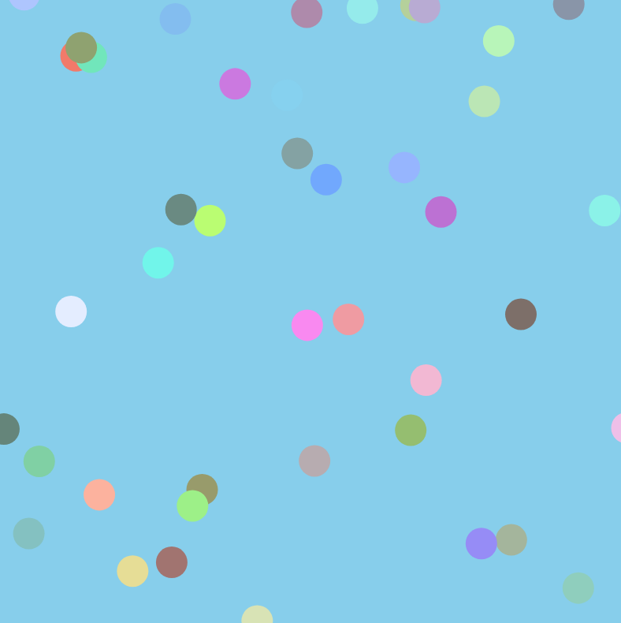

# Colorful bouncing balls

Juna Kim

[View this project online](https://june2174.github.io/CART253/Challenges/Arrays/arrays%20challenges/)

## Description

For colorful bouncing balls I adjusted the original code so I can have endless balls with colors when original code had one black ball. In order to do that, I made a balls array and created a mousePressed function to create more balls on canvas as I press the mouse. In mousePressed function, I made a ball to be created at mouse position and put the created balls in to the balls array.
For better visual I set the r,g,b randomly and filled a ball with color(r,g,b).

## Screenshot(s)

## Attribution
- This project uses [p5.js](https://p5js.org).
- Making the circles have the random color, refer to my code which I made a few years ago [Color code](https://editor.p5js.org/juna2174/sketches/x7Ot5-yoc)