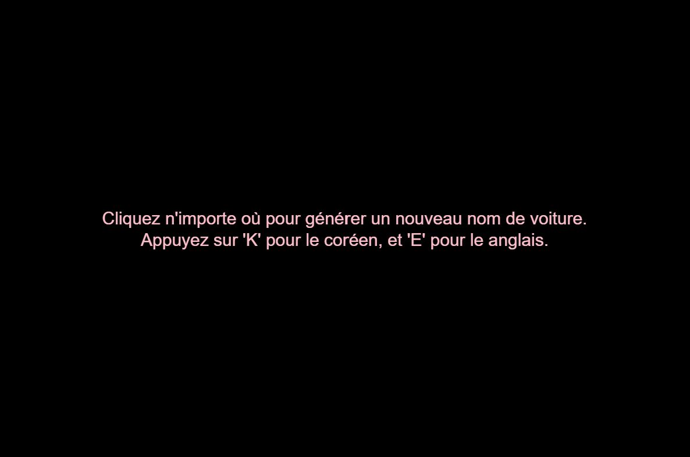

# Terrible Car Name Generator

Juna Kim

[View this project online](https://june2174.github.io/CART253/Challenges/Data/data%20challenges/)

## Description

This challenge uses three json file. cars.json and dinosaurs.json are provided and I wrote lang.json. cars and dinosaurs json files have loads of name of each cars and dinosaurs. So the code reads the files and as I press the mouse, it randomly picks one word from each file, combines them and give us the name of the car. Also we have instructions, in lang.json I put instructions in three different language, english, french, and korean. Code also reads the lang.json. I initialized the language to english, but I also made it possible to change the language by pressing the key (e,f,k).

## Screenshot(s)

## Attribution

- This project uses [p5.js](https://p5js.org).
- Uses file from [Darius Kazemi's corpora repository](https://github.com/dariusk/corpora/tree/master).