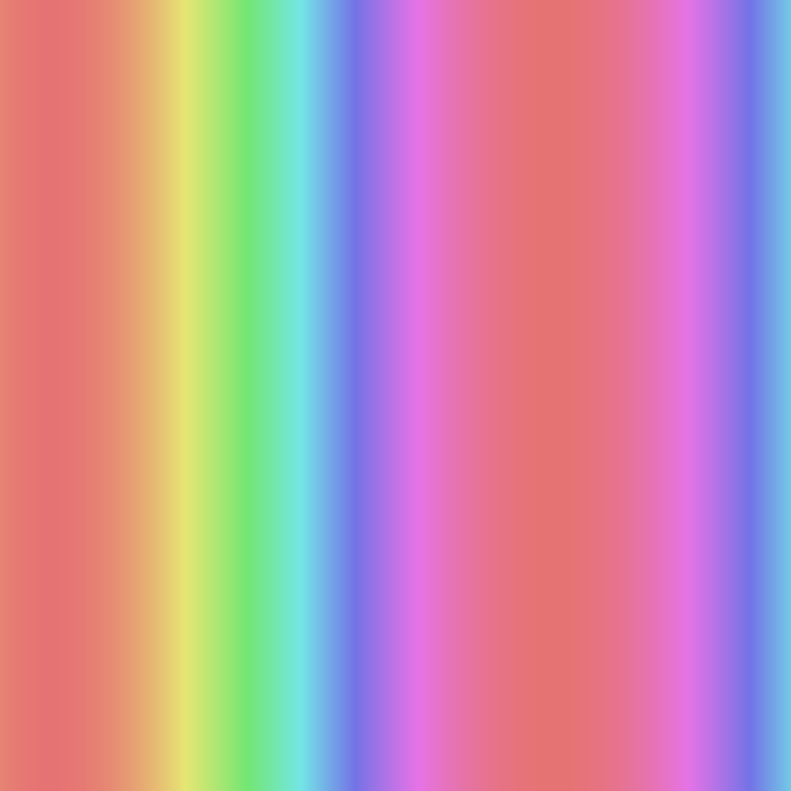

# Moving Gradient

Juna Kim

[View this project online](https://june2174.github.io/CART253/Challenges/Loops/loops%20challenge/)

## Description

I made a moving gradient. By using Colormode I adjusted brightness and saturation. I also used map and sin to make color gradient, frameCount to make it move. Since sin gives us -1 to 1, I needed map to turn the number into 0 to 360 for color. By adding x * 0.01 to frameCount, I made colorful Gradient.

## Screenshot(s)

## Attribution

- This project uses [p5.js](https://p5js.org).
